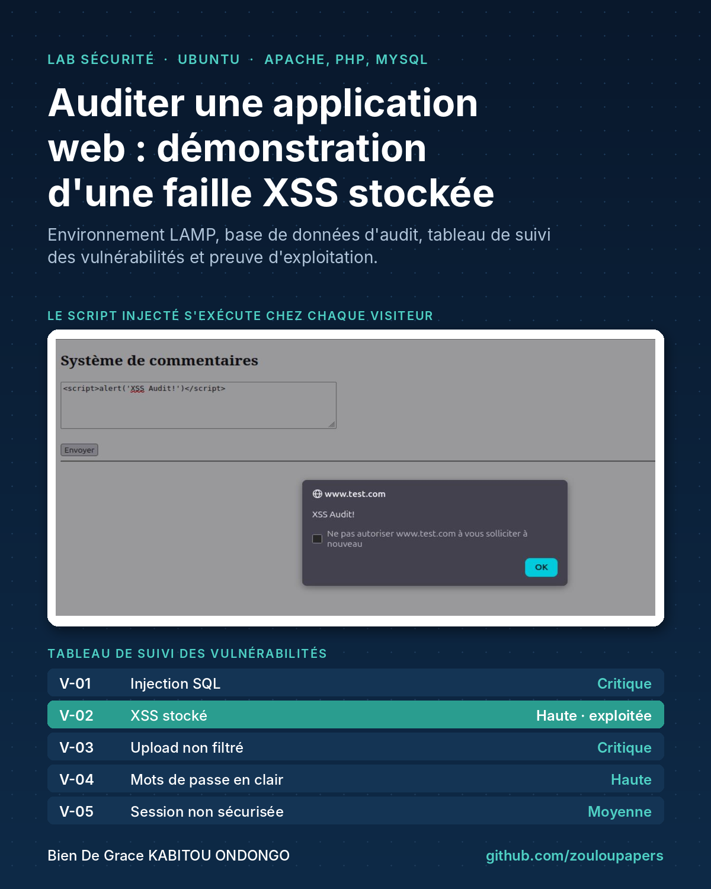
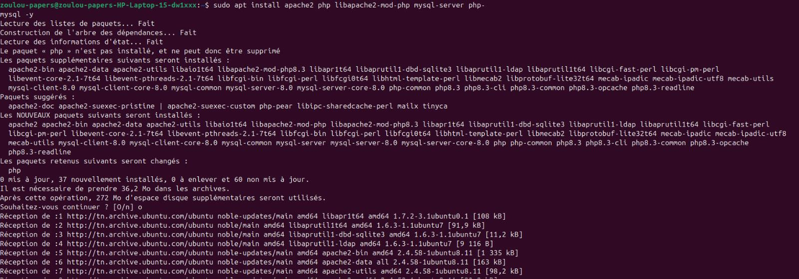
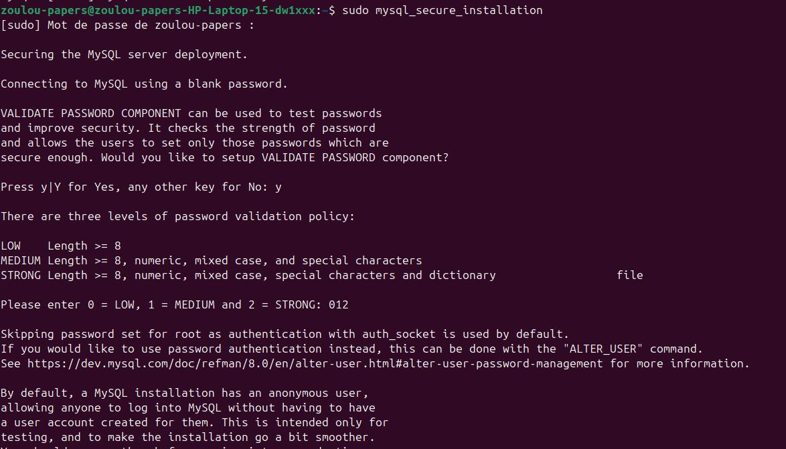
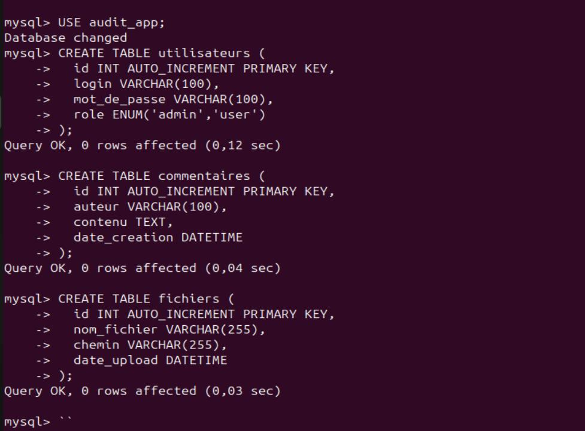
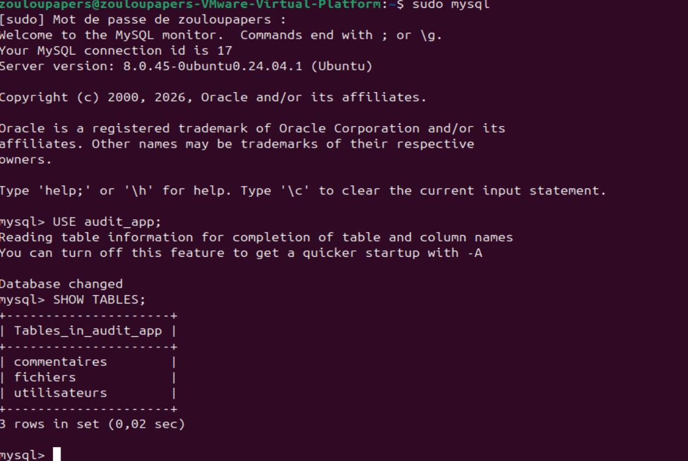
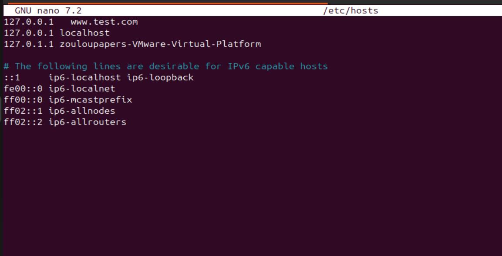
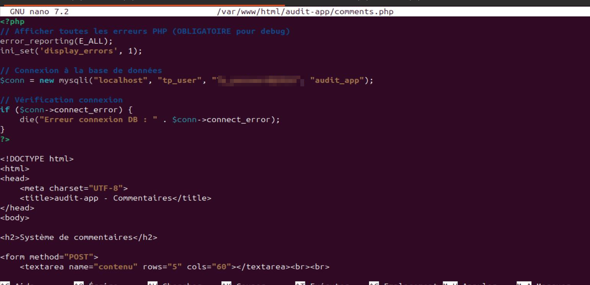
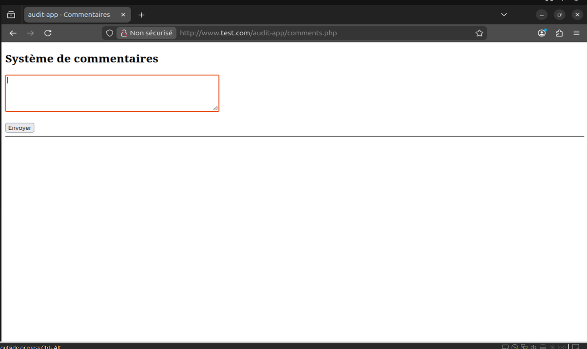
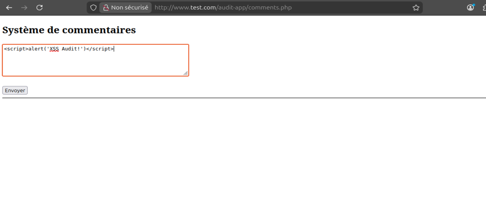
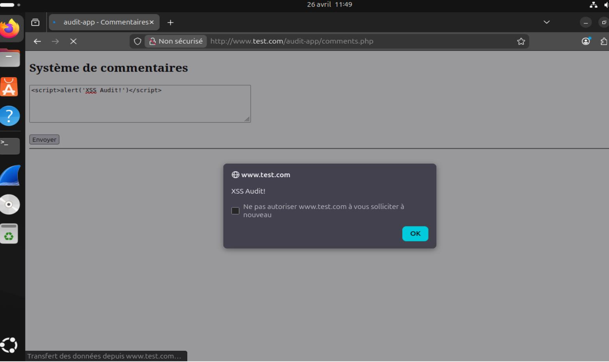

# Audit de sécurité d'une application web : faille XSS stockée

> **EN**: Security lab on an Ubuntu virtual machine. It covers a LAMP stack (Apache, PHP, MySQL), the database of a deliberately vulnerable internal PHP application, a vulnerability tracking table, and a proof of concept of a stored XSS in the comments page.

Projet réalisé dans le cadre du module Sécurité informatique (L2 Ingénierie des réseaux et systèmes, Université Centrale, Tunis), avril 2026.

> ⚠️ Lab pédagogique : l'application est volontairement vulnérable et n'a tourné que sur une machine virtuelle locale. Ne jamais la déployer sur un serveur accessible.

## Contexte

Le scénario : un stagiaire en sécurité d'une PME reçoit une application interne PHP/MySQL (connexion des employés, commentaires, dépôt de documents). Il doit l'auditer, démontrer les failles et proposer des corrections. Le cas qui m'a été attribué est la **faille XSS stockée**.

## Environnement

- Ubuntu 24.04 dans une machine virtuelle VMware
- Apache 2, PHP, MySQL 8.0
- Domaine local `www.test.com` déclaré dans `/etc/hosts`, application servie sur `http://www.test.com/audit-app`

## Étapes réalisées

1. **Installation de la pile LAMP** (`apache2`, `php`, `mysql-server`, `libapache2-mod-php`, `php-mysql`), puis sécurisation de MySQL avec `mysql_secure_installation`.
2. **Base de données** `audit_app` avec un utilisateur dédié `tp_user`, dont les droits sont limités à cette base.
3. **Tables** :
   - `utilisateurs` (id, login, mot_de_passe, role),
   - `commentaires` (id, auteur, contenu, date_creation),
   - `fichiers` (id, nom_fichier, chemin, date_upload).
4. **Application** : `login.php`, `comments.php`, `upload.php`, `session.php` et `db.php`.
5. **Tableau de suivi des vulnérabilités** (ci-dessous).
6. **Démonstration de la faille XSS stockée** dans `comments.php` : un commentaire contenant `` est enregistré en base, puis exécuté dans le navigateur de chaque personne qui ouvre la page.

## Tableau de suivi des vulnérabilités

| N° | Vulnérabilité | Fichier | Criticité | Statut |
|---|---|---|---|---|
| V-01 | Injection SQL | `login.php` | Critique | Identifiée |
| V-02 | XSS stocké | `comments.php` | Haute | **Exploitée** |
| V-03 | Upload non filtré | `upload.php` | Critique | Identifiée |
| V-04 | Mots de passe stockés en clair | `login.php` | Haute | Identifiée |
| V-05 | Session non sécurisée | `session.php` | Moyenne | Identifiée |

## Pourquoi c'est grave

Le script injecté s'exécute avec les droits de la victime sur le site. Un attaquant pourrait voler les cookies de session, modifier la page ou rediriger les utilisateurs. Comme le commentaire est stocké en base, chaque visiteur est touché, sans aucune action de sa part.

## Corrections recommandées

| Vulnérabilité | Correction |
|---|---|
| V-02 XSS stocké | Échapper toute donnée affichée avec `htmlspecialchars($texte, ENT_QUOTES, 'UTF-8')`, ajouter un en-tête `Content-Security-Policy` et des cookies `HttpOnly`, `Secure` et `SameSite` |
| V-01 Injection SQL | Utiliser des requêtes préparées (`mysqli::prepare` ou PDO) |
| V-03 Upload non filtré | Vérifier le type MIME et l'extension, renommer les fichiers, les stocker hors du dossier web |
| V-04 Mots de passe en clair | `password_hash()` et `password_verify()` |
| V-05 Session non sécurisée | `session_regenerate_id(true)` après la connexion, durée de session limitée |
| Configuration | Désactiver `display_errors` en production, ne jamais écrire les identifiants de la base dans le code source |

## Captures

| Installation de la pile LAMP | Sécurisation de MySQL |
|---|---|
|  |  |

| Création des tables | Vérification des tables |
|---|---|
|  |  |

| Domaine local dans /etc/hosts | Code de comments.php (mot de passe masqué) |
|---|---|
|  |  |

| Formulaire de commentaires | Injection du script |
|---|---|
|  |  |

## Compétences mobilisées

Linux (Ubuntu) · Apache · PHP · MySQL · sécurité des applications web (OWASP) · XSS · audit et rapport de vulnérabilités

## Auteur

**KABITOU ONDONGO Bien De Grace**, étudiant en L3 Ingénierie des réseaux et systèmes. Voir [github.com/zouloupapers](https://github.com/zouloupapers).
